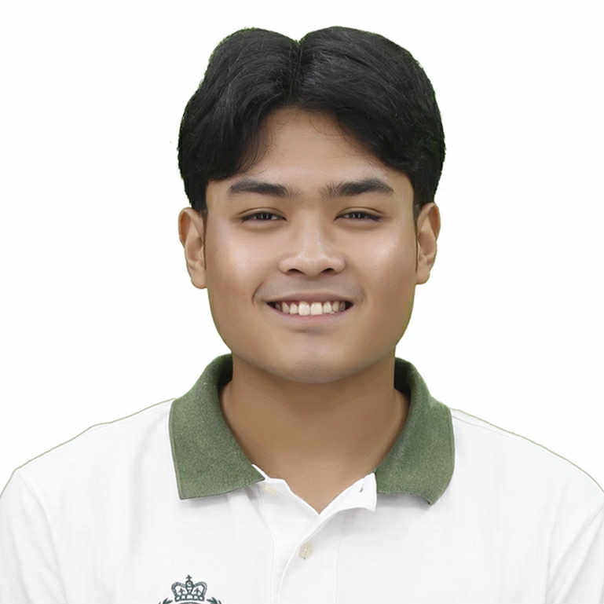

# Juliam L. Alderite

**BS Nursing 4F**  
**Ateneo de Davao University**

*Exploring creativity, technology, innovation, and digital skills.*

---

## 👋 About Me

Hello! I am **Juliam L. Alderite**, a Bachelor of Science in Nursing student at **Ateneo de Davao University**.

I am interested in healthcare, creative projects, dance, digital design, artificial intelligence, and learning how technology can be used to develop practical solutions.

Through GE 4120 – 21st Century IT Skills, I have explored different digital tools and applied them to academic and creative projects. This portfolio showcases my learning journey and the skills I have developed throughout the course.

## 💻 Skills and Tools Learned

- 🎨 **Digital Design:** Poster creation, visual communication, color palettes, and typography.
- 🤖 **Artificial Intelligence:** Using AI tools to generate ideas, improve prompts, and assist with project development.
- 🌐 **Website Development:** Planning website content, organizing pages, and exploring AI-assisted website creation.
- 📄 **Digital Documents:** Preparing and organizing presentations, resumes, PDFs, and project documentation.
- 💻 **GitHub:** Repository organization, file uploads, Markdown, and README documentation.

## 📚 My Portfolio Activities

This repository contains my activities, projects, and outputs for GE 4120.

### 🎨 Activity 1 – Presentation Design Principles

Exploring the fundamentals of effective presentation design and visual communication.

[**→ View Activity 1**](./Activity%201%20-%20Presentation%20Design%20Principles/)

---

### 🖌️ Activity 2 – Color Palette and Typography

Developing a personal visual identity through logo design, color combinations, and typography.

[**→ View Activity 2**](./Activity%202%20-%20Color%20Palette%20and%20Typography/)

---

### 💡 Activity 3 – Technology-Based Solution

Introducing HOMEHELP PH, a proposed mobile and web platform providing support and referrals for homeless children and families.

[**→ View Activity 3**](./Activity%203%20-%20Technology-Based%20Solution/)

---

### 🤖 Activity 5 – AI Tools Activity

Exploring prompt improvement and AI-generated website development through a Hot Wheels marketplace project.

[**→ View Activity 5**](./Activity%205%20-%20AI%20Tools%20Activity/)

---

### 🌿 Activity 6 – Making a Website

Developing GreenFN, a fitness and nutrition website concept using AI-assisted website creation.

[**→ View Activity 6**](./Activity%206%20-%20Making%20a%20Website/)

---

### 📄 Activity 7 – Resume Generating

Using and comparing AI tools such as ChatGPT and Claude AI to generate professional nursing resume outputs.

[**→ View Activity 7**](./Activity%207%20-%20Resume%20Generating/)

---

## 🎯 My Learning Goals

Through this course, I aim to:

- Improve my digital literacy and technological skills.
- Develop creativity and problem-solving abilities.
- Learn how to use AI tools effectively and responsibly.
- Apply technology to academic, professional, and real-world situations.
- Continue exploring digital innovation and website development.

---

### ✨ DREAM. DESIGN. DEVELOP.

**GE 4120 – 21st Century IT Skills**

*Digital Portfolio by Juliam L. Alderite*

